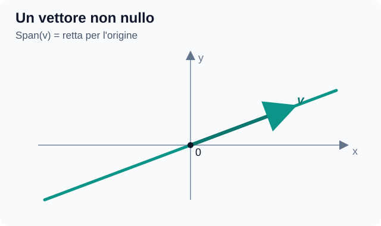
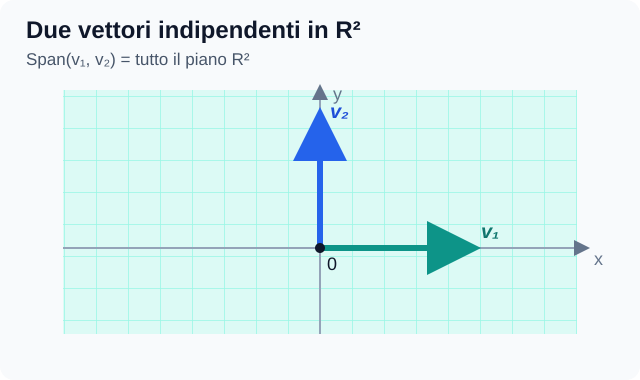
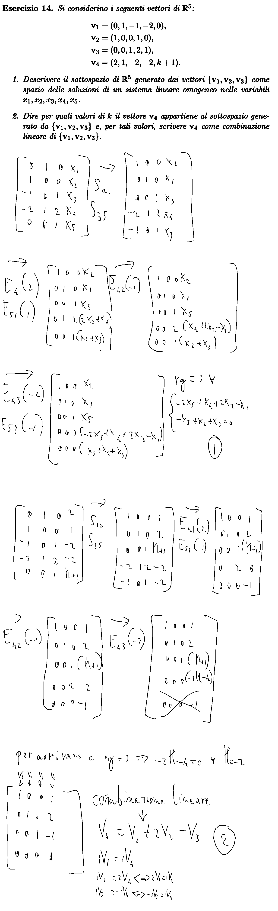
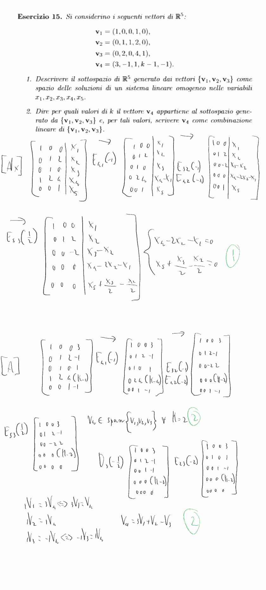
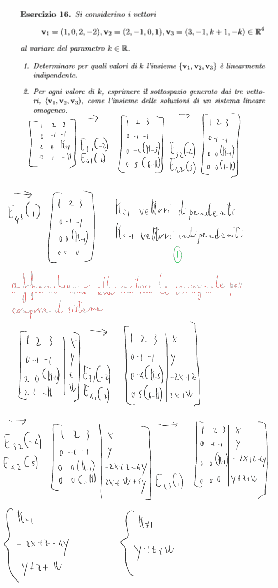
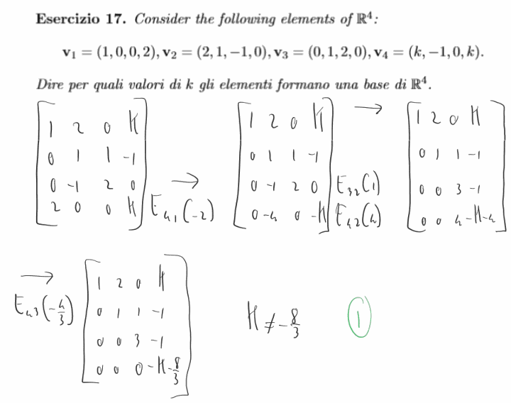

# Capitolo 4 — Spazi vettoriali

**Dispensa:** *Geometria e Algebra Lineare*, Elisa Postinghel  
**Capitolo:** 4 — Spazi vettoriali (pp. 86–107 del PDF, numerazione stampata)

> Documento incrementale. Qui aggiungeremo spiegazioni, esempi e chiarimenti su richiesta, mantenendo sempre lo stesso nome.

## Indice

- [4.1 — Spazi vettoriali reali (p. 86)](#indice-cap4-1)
  - [Definizione completa e otto proprietà di uno spazio vettoriale reale (lezione, p. 1)](#indice-cap4-2)
  - [Che cosa si intende per «vettore»?](#indice-cap4-3)
  - [Operazioni sulle ennuple di ℝⁿ (lezione, p. 2)](#indice-cap4-4)
- [4.2 — Combinazioni lineari (p. 88)](#indice-cap4-5)
  - [Come funzionano le combinazioni lineari (lezioni, pp. 2–3)](#indice-cap4-6)
  - [4.2.1 — Forma matriciale (p. 89)](#indice-cap4-7)
- [4.3 — Sottospazi vettoriali e generatori (p. 89)](#indice-cap4-8)
  - [4.3.1 — Sottospazi vettoriali](#indice-cap4-9)
    - [Esempi e controesempi di sottospazi con matrici e polinomi (lezioni, pp. 5 e 13–14)](#indice-cap4-10)
    - [Spazio delle soluzioni di un sistema lineare omogeneo](#indice-cap4-11)
    - [Procedimento completo: dallo Span a un sistema omogeneo (lezioni, pp. 10–11)](#indice-cap4-12)
  - [4.3.2 — Generatori (p. 92)](#indice-cap4-13)
  - [Significato dello Span](#indice-cap4-14)
  - [Interpretazione geometrica](#indice-cap4-15)
  - [Altri esempi di spazi vettoriali: matrici, polinomi e funzioni (lezioni, pp. 11–13)](#indice-cap4-16)
  - [Spazio delle righe e spazio delle colonne (lezione, p. 9; dispensa, §6.3)](#indice-cap4-17)
- [4.4 — Insiemi linearmente dipendenti e indipendenti (p. 95)](#indice-cap4-18)
  - [Esempio 60 — Indipendenza lineare di matrici (dispensa, p. 96)](#indice-cap4-19)
  - [4.4.1 — Indipendenza lineare e rango (pp. 97–98)](#indice-cap4-20)
    - [Esempio 61 — Dipendenza lineare e rango (p. 98)](#indice-cap4-21)
    - [Esempio 62 — Relazione tra i vettori (continuazione dell'Esempio 61, pp. 98–99)](#indice-cap4-22)
- [4.5 — Basi (p. 99)](#indice-cap4-23)
  - [Unicità dei coefficienti rispetto a una base (lezioni, pp. 19–20)](#indice-cap4-24)
  - [4.5.1 — Basi di ℝⁿ](#indice-cap4-25)
  - [Criterio del rango per riconoscere una base (lezioni, pp. 21–22)](#indice-cap4-26)
  - [Esempi di basi in spazi diversi da ℝⁿ (lezioni, pp. 20–21)](#indice-cap4-27)
  - [Esempio 65 — Ricavare i coefficienti di un vettore rispetto a una base (p. 100)](#indice-cap4-28)
- [4.6 — Esercizi ricapitolativi (p. 101)](#indice-cap4-29)
  - [Esercizio 13 — Sottospazio generato e appartenenza di un vettore](#indice-cap4-30)
    - [Punto 1 — Trovare una base](#indice-cap4-31)
    - [Punto 2 — Verificare se il vettore appartiene a U](#indice-cap4-32)
  - [Esercizio 14 — Testo e svolgimento manoscritto (Samsung Notes)](#indice-cap4-33)
  - [Esercizio 15 — Testo e svolgimento manoscritto](#indice-cap4-34)
  - [Esercizio 16 — Testo e svolgimento manoscritto](#indice-cap4-35)
  - [Esercizio 17 — Testo e svolgimento manoscritto](#indice-cap4-36)
- [Appunti personali e chiarimenti successivi](#indice-cap4-37)

---

## 4.1 — Spazi vettoriali reali (p. 86)

**Definizione:** Uno spazio vettoriale è un insieme dotato delle operazioni di somma e di prodotto di un elemento per uno scalare.

In uno **spazio vettoriale reale** gli scalari sono numeri reali. Le operazioni devono soddisfare le otto proprietà della Definizione 37 (commutatività e associatività della somma, vettore nullo, opposto, proprietà del prodotto per uno scalare e distributività).

Esempi della dispensa: vettori geometrici, $\mathbb R^n$, matrici $M_{m\times n}(\mathbb R)$, polinomi.

### Definizione completa e otto proprietà di uno spazio vettoriale reale (lezione, p. 1)

Uno **spazio vettoriale reale** è un insieme non vuoto $V$, i cui elementi sono chiamati **vettori**, su cui sono definite le operazioni di **somma** $v+w\in V$ e **prodotto per uno scalare** $\lambda v\in V$ per $\lambda\in\mathbb R$.

Per ogni $u,v,w\in V$ e ogni $\lambda,\mu\in\mathbb R$ devono valere **tutti e otto** gli assiomi:

1. **Commutatività della somma:** $v+w=w+v$.
2. **Associatività della somma:** $(u+v)+w=u+(v+w)$.
3. **Esistenza del vettore nullo:** esiste $0_V\in V$ tale che $v+0_V=v$.
4. **Esistenza dell'opposto:** per ogni $v$ esiste $-v\in V$ tale che $v+(-v)=0_V$.
5. **Associatività del prodotto per scalare:** $\lambda(\mu v)=(\lambda\mu)v$.
6. **Unità del prodotto per scalare:** $1v=v$.
7. **Distributività rispetto agli scalari:** $(\lambda+\mu)v=\lambda v+\mu v$.
8. **Distributività rispetto ai vettori:** $\lambda(v+w)=\lambda v+\lambda w$.

Queste sono le proprietà che **definiscono** lo spazio vettoriale. Il vettore nullo dipende dallo spazio: ennupla nulla in $\mathbb R^n$, matrice nulla nello spazio delle matrici, polinomio nullo nello spazio dei polinomi.

### Che cosa si intende per «vettore»?

Il termine **vettore**, nel suo significato più generale, indica **un elemento di uno spazio vettoriale**. Non va confuso con alcuni suoi casi particolari:

- **Vettore geometrico:** una classe di equivalenza di segmenti orientati.
- **Vettore riga:** una matrice formata da una sola riga.
- **Vettore colonna:** una matrice formata da una sola colonna.

**Attenzione:** questi oggetti non sono sinonimi. La nozione più generale è quella di *vettore come elemento di uno spazio vettoriale*; gli altri sono esempi particolari.

In particolare:

- L'insieme $V^3$ dei **vettori geometrici**, introdotto nel Capitolo 1, è uno spazio vettoriale.
- L'insieme $M_{m\times n}(\mathbb R)$ delle **matrici $m\times n$ a coefficienti reali** è anch'esso uno spazio vettoriale.

### Operazioni sulle ennuple di $\mathbb R^n$ (lezione, p. 2)

Una **ennupla** è un vettore $v=(v_1,\ldots,v_n)$ con $n$ componenti reali. Se $w=(w_1,\ldots,w_n)$, le operazioni si fanno **componente per componente**:

$$
v+w=(v_1+w_1,\ldots,v_n+w_n),\qquad
\lambda v=(\lambda v_1,\ldots,\lambda v_n).
$$

Il vettore nullo è $(0,\ldots,0)$ e l'opposto di $v$ è $(-v_1,\ldots,-v_n)$.

**Esempio della lezione:** se $v=(1,1,1)$, $w=(2,3,4)$ e scegliamo i coefficienti $2$ e $-1$, allora

$$
2v-w=2(1,1,1)-(2,3,4)=(0,-1,-2).
$$

Queste operazioni soddisfano gli otto assiomi, quindi $\mathbb R^n$ è uno spazio vettoriale reale.

## 4.2 — Combinazioni lineari (p. 88)

Una **combinazione lineare** dei vettori $v_1,\ldots,v_k$ è

$$
v=\lambda_1v_1+\cdots+\lambda_kv_k.
$$

I numeri $\lambda_i$ sono i **coefficienti** o **scalari** (informalmente, i «pesi»).

### Come funzionano le combinazioni lineari (lezioni, pp. 2–3)

Una combinazione lineare **produce un vettore** (non un insieme di vettori): si moltiplica ciascuno dei $k$ vettori iniziali per un coefficiente, poi si somma tutto. Se i vettori sono in $\mathbb R^n$, anche il risultato è in $\mathbb R^n$.

**Attenzione ai due numeri:** $k$ è il **numero di vettori da combinare**, mentre $n$ è il **numero di componenti per vettore**.

### 4.2.1 — Forma matriciale (p. 89)

Disponiamo i vettori **nelle colonne** di una matrice:

$$
A=[v_1\mid v_2\mid\cdots\mid v_k].
$$

Raccogliamo i coefficienti nel **vettore colonna**:

$$
\underline{\lambda}= \begin{pmatrix} \lambda_1\\ \lambda_2\\ \vdots\\ \lambda_k \end{pmatrix}.
$$

In questo modo, la combinazione lineare diventa $A\underline{\lambda}=v$.

**Chiarimento discusso:** $\underline{\lambda}$ non contiene i vettori originali: contiene soltanto i pesi. Se $A$ ha quattro colonne, $\underline{\lambda}$ ha quattro coefficienti.

**Dimensioni della forma matriciale.** Se si combinano $k$ vettori di $\mathbb R^n$, disponendoli nelle colonne si ottiene $A\in M_{n\times k}(\mathbb R)$: **$n$ righe (componenti) e $k$ colonne (vettori)**. Il vettore dei coefficienti $\underline{\lambda}$ ha dimensione $k\times1$ e $A\underline{\lambda}$ ha dimensione $n\times1$.

**Esempio:** tre vettori in $\mathbb R^5$ danno una matrice **$5\times3$** e richiedono **tre** coefficienti $\lambda_1,\lambda_2,\lambda_3$.

## 4.3 — Sottospazi vettoriali e generatori (p. 89)

### 4.3.1 — Sottospazi vettoriali

Un sottoinsieme non vuoto $U\subseteq V$ è un **sottospazio vettoriale** se è chiuso per somma e prodotto per scalare. In modo equivalente, per ogni $u_1,u_2\in U$ e $\lambda_1,\lambda_2\in\mathbb R$,

$$
\lambda_1u_1+\lambda_2u_2\in U.
$$

Ogni sottospazio deve contenere il **vettore nullo** di $V$, indicato con $0_V$. Questo vale per ogni sottospazio $U\subseteq V$, ma **non** per un sottoinsieme qualsiasi di $V$.

**Test del vettore nullo (condizione necessaria).** Se $U\subseteq\mathbb{R}^n$ **non contiene il vettore nullo**, allora **non è un sottospazio vettoriale**. Infatti, se $U$ è un sottospazio e $v\in U$, per la chiusura rispetto al prodotto per uno scalare deve valere

$$
0\cdot v=\mathbf{0}\in U.
$$

**Attenzione:** contenere il vettore nullo è **necessario, ma non sufficiente** per essere un sottospazio. Se $\mathbf{0}\in U$, bisogna comunque verificare anche la **chiusura rispetto alla somma** e la **chiusura rispetto al prodotto per uno scalare**.

**Numero di elementi di un sottospazio vettoriale reale.** Un sottospazio $U$ può avere:

- **Un solo elemento:** in questo caso è necessariamente il vettore nullo, quindi $U=\{0_V\}$. Questo insieme è detto **sottospazio nullo**.
- **Infiniti elementi:** se $U$ contiene almeno un vettore non nullo $v$, per la chiusura rispetto al prodotto per uno scalare contiene anche tutti i vettori $\lambda v$, al variare di $\lambda\in\mathbb{R}$; essi sono infiniti e distinti.

**Conclusione:** un sottospazio vettoriale reale ha **un solo elemento (lo zero) oppure infiniti elementi**. Non può avere un numero finito di elementi maggiore di uno.

#### Esempi e controesempi di sottospazi con matrici e polinomi (lezioni, pp. 5 e 13–14)

Per dimostrare che un insieme non vuoto $U$ **è** un sottospazio, si verifica che per ogni $u,v\in U$ e ogni $\lambda,\mu\in\mathbb R$ anche $\lambda u+\mu v$ vi appartiene. Per dimostrare che **non lo è**, basta trovare una condizione necessaria che fallisce.

**1. Matrici $2\times2$ con traccia nulla: è un sottospazio.** La **traccia** di una matrice quadrata è la somma degli elementi sulla diagonale principale:

$$
\mathrm{tr}\begin{pmatrix}
a&b\\
c&d
\end{pmatrix}=a+d.
$$

Indichiamo con $U$ l'insieme delle matrici $A\in M_2(\mathbb R)$ la cui traccia è nulla, cioè quelle per cui $\mathrm{tr}(A)=0$.

In altre parole, **le matrici di $U$ sono esattamente quelle della forma**:

$$
A=\begin{pmatrix}
a&b\\
c&-a
\end{pmatrix},
\qquad a,b,c\in\mathbb R.
$$

La matrice nulla appartiene a $U$. Inoltre, se $A,B\in U$, allora

$$
\mathrm{tr}(\lambda A+\mu B)=\lambda\mathrm{tr}(A)+\mu\mathrm{tr}(B)=0.
$$

Quindi **$U$ è chiuso** rispetto alle combinazioni lineari. *Approfondimento:* ogni sua matrice è combinazione lineare delle seguenti matrici:

$$
B_1=\begin{pmatrix}1&0\cr0&-1\end{pmatrix},
\quad
B_2=\begin{pmatrix}0&1\cr0&0\end{pmatrix},
\quad
B_3=\begin{pmatrix}0&0\cr1&0\end{pmatrix}.
$$

Precisamente, ogni matrice $A\in U$ si scrive come

$$
A=aB_1+bB_2+cB_3.
$$

**2. Matrici invertibili: non è un sottospazio.** L'insieme delle matrici invertibili in $M_2(\mathbb R)$ **non contiene la matrice nulla** (che non è invertibile): fallisce il test del vettore nullo.

**3. Polinomi che si annullano in $1$: è un sottospazio.** Consideriamo $U=\{p(x)\in\mathbb R[x]:p(1)=0\}$. Contiene il polinomio nullo. Se $p(1)=q(1)=0$, allora $(\lambda p+\mu q)(1)=\lambda p(1)+\mu q(1)=0$, quindi è **chiuso**. *Approfondimento:* sono esattamente i polinomi divisibili per $x-1$.

**4. Polinomi di grado esattamente $d$: non è un sottospazio.** Il polinomio nullo **non** ha grado esattamente $d$. Inoltre, per ogni $d\ge0$, $p(x)=x^d$ e $q(x)=-x^d$ hanno grado $d$, ma $p+q=0$ non lo ha: la chiusura per somma fallisce.

**Da distinguere:** «grado **esattamente** $d$» non definisce un sottospazio; «grado **al più** $d$» definisce invece un sottospazio.

#### Spazio delle soluzioni di un sistema lineare omogeneo

Un **sistema lineare omogeneo** è un sistema in cui tutti i termini noti sono uguali a zero, e si scrive in forma matriciale $Bx=\mathbf{0}$.

Lo **spazio delle soluzioni** è l'insieme di **tutti i vettori $x$ che soddisfano contemporaneamente le equazioni** del sistema:

$$
U=\{x\in\mathbb{R}^n\mid Bx=\mathbf{0}\}.
$$

Questo insieme è sempre un **sottospazio vettoriale di $\mathbb{R}^n$**: contiene il vettore nullo ed è chiuso rispetto alla somma e al prodotto per uno scalare.

**Da ricordare:** lo stesso sottospazio può essere descritto tramite **generatori** (come Span di alcuni vettori) oppure tramite **equazioni omogenee** che i suoi vettori devono soddisfare.

#### Procedimento completo: dallo Span a un sistema omogeneo (lezioni, pp. 10–11)

**Che cosa chiede l'esercizio?** Partendo da $U=\mathrm{Span}(v_1,\ldots,v_k)\subseteq\mathbb R^n$, bisogna **trovare equazioni** nelle coordinate di un vettore generico $x$ che individuino *tutti e soli* i vettori appartenenti a $U$; non si sta cercando una singola soluzione.

1. Disponiamo i **generatori nelle colonne** di $A=[v_1\mid\cdots\mid v_k]$ e aggiungiamo il vettore generico $x$ come **ultima colonna**, formando $(A\mid x)$.
2. La condizione $x\in U$ equivale alla compatibilità del sistema $A\underline{\lambda}=x$, in cui le incognite $\lambda_i$ sono i **coefficienti della combinazione lineare**.
3. Applichiamo Gauss alla matrice aumentata **per intero**, compresa l'ultima colonna.
4. Per il teorema di **Rouché–Capelli**, richiediamo $\mathrm{rg}(A)=\mathrm{rg}(A\mid x)$. Quando una riga ha **tutti zeri nella parte relativa ad $A$**, dobbiamo porre **uguale a zero** anche l'espressione dell'ultima colonna: otteniamo così le **equazioni omogenee cercate**. È sufficiente la **forma a scalini**, senza riduzione all'indietro.

**Esempio effettivamente svolto nelle lezioni.** Consideriamo

$$
v_1=(-1,1,0,-3),\qquad v_2=(1,-1,2,1),\qquad
U=\mathrm{Span}(v_1,v_2)\subseteq\mathbb R^4.
$$

Se $x=(x,y,z,w)$ è un vettore **generico**:

$$
(A\mid x)=\left(\begin{array}{cc|c}
-1&1&x\\
1&-1&y\\
0&2&z\\
-3&1&w
\end{array}\right).
$$

Eseguiamo $R_2\leftarrow R_2+R_1$ e $R_4\leftarrow R_4-3R_1$:

$$
\left(\begin{array}{cc|c}
-1&1&x\\
0&0&x+y\\
0&2&z\\
0&-2&w-3x
\end{array}\right).
$$

Scambiamo la seconda e la terza riga, poi eseguiamo $R_4\leftarrow R_4+R_2$:

$$
\left(\begin{array}{cc|c}
-1&1&x\\
0&2&z\\
0&0&x+y\\
0&0&z+w-3x
\end{array}\right).
$$

La parte $A$ ha rango $2$. L'ultima colonna **non deve aumentare il rango**, dunque occorre imporre

$$
\boxed{\begin{cases}
x+y=0,\\
z+w-3x=0.
\end{cases}}
$$

Quindi abbiamo ottenuto **una descrizione tramite equazioni dello stesso sottospazio**:

$$
U=\mathrm{Span}(v_1,v_2)
=\{(x,y,z,w)\in\mathbb R^4:x+y=0,\ z+w-3x=0\}.
$$

**Non confondere:** $\lambda_1,\lambda_2$ sono i coefficienti *usati per generare* i vettori; $x,y,z,w$ sono le **coordinate** di un vettore generico, che devono rispettare le equazioni. Sistemi scritti in forme diverse vanno ugualmente bene se hanno **esattamente lo stesso insieme delle soluzioni**.

### 4.3.2 — Generatori (p. 92)

Lo **spazio generato** da $v_1,\ldots,v_k$ contiene tutte le loro combinazioni lineari:

$$
\mathrm{Span}(v_1,\ldots,v_k)= \{\lambda_1v_1+\cdots+\lambda_kv_k:\lambda_i\in\mathbb R\}.
$$

Un insieme è un **sistema di generatori** di $V$ se il suo span coincide con $V$.

### Significato dello Span

**Span** significa **spazio generato**: è l'insieme di **tutti** i vettori ottenibili facendo combinazioni lineari dei vettori di partenza, non soltanto l'insieme dei vettori iniziali.

Per esempio, dati due vettori $v_1$ e $v_2$:

$$
\mathrm{Span}(v_1,v_2) =\{\lambda_1v_1+\lambda_2v_2\mid \lambda_1,\lambda_2\in\mathbb{R}\}.
$$

I coefficienti $\lambda_1$ e $\lambda_2$ possono assumere **qualsiasi valore reale**.

**Esempio in $\mathbb{R}^2$.** Prendiamo $v_1=(1,0)$ e $v_2=(0,1)$. Ogni combinazione lineare è

$$
\lambda_1(1,0)+\lambda_2(0,1) =(\lambda_1,\lambda_2).
$$

Poiché $\lambda_1$ e $\lambda_2$ possono essere qualsiasi numero reale, si ottiene ogni vettore del piano:

$$
\boxed{\mathrm{Span}(v_1,v_2)=\mathbb{R}^2}.
$$

### Interpretazione geometrica

**1. Un solo vettore non nullo:** il suo Span è la **retta passante per l'origine** nella direzione del vettore.

**2. Due vettori linearmente indipendenti in $\mathbb{R}^2$:** il loro Span è **l'intero piano $\mathbb{R}^2$**.

**Collegamento con le matrici.** Se $A$ ha per colonne i vettori $v_1,\ldots,v_k$, allora

$$
v\in\mathrm{Span}(v_1,\ldots,v_k) \quad\Longleftrightarrow\quad A\underline{\lambda}=v \ \text{ammette almeno una soluzione}.
$$

I coefficienti cercati sono le componenti del vettore colonna $\underline{\lambda}$.

Per vettori in $\mathbb R^n$, scritti nelle colonne di $A$:

- $v$ appartiene allo spazio generato se il sistema $A\underline{\lambda}=v$ è **compatibile**.
- I vettori generano **tutto $\mathbb R^n$** se e solo se $\mathrm{rg}(A)=n$, dove $n$ è il numero delle **righe**.

### Altri esempi di spazi vettoriali: matrici, polinomi e funzioni (lezioni, pp. 11–13)

**Spazio delle matrici** $M_{m\times n}(\mathbb R)$: i vettori sono *matrici*; la somma e il prodotto per scalare si effettuano componente per componente. Il vettore nullo è la matrice nulla.

**Spazio dei polinomi** $\mathbb R[x]$: contiene tutti i polinomi reali in $x$, di grado arbitrario, con le operazioni usuali. **Non è finitamente generato.** Dimostriamolo: scelti comunque un numero finito di polinomi $p_1,\ldots,p_k$, sia $M$ il massimo dei loro gradi. Tutte le combinazioni lineari di questi polinomi hanno grado **al più $M$**, quindi non si può ottenere il polinomio $x^{M+1}$. Pertanto nessuna famiglia finita genera tutto $\mathbb R[x]$.

**Polinomi di grado al più $d$:** l'insieme

$$
\mathbb R[x]_{\le d}
=\{a_0+a_1x+\cdots+a_dx^d:a_0,\ldots,a_d\in\mathbb R\}
$$

è un **sottospazio** di $\mathbb R[x]$ ed è **finitamente generato** dall'insieme $\{1,x,\ldots,x^d\}$.

**Spazio delle funzioni continue** $C(\mathbb R)$: contiene le funzioni continue $f:\mathbb R\to\mathbb R$. Le operazioni sono definite **punto per punto**:

$$
(f+g)(x)=f(x)+g(x),\qquad
(\lambda f)(x)=\lambda f(x).
$$

La somma e il prodotto per scalare di funzioni continue sono ancora continui.

### Spazio delle righe e spazio delle colonne (lezione, p. 9; dispensa, §6.3)

Data una matrice $A$ con **$m$ righe e $n$ colonne**, le sue righe sono vettori $r_1,\ldots,r_m\in\mathbb R^n$, mentre le sue colonne sono vettori $c_1,\ldots,c_n\in\mathbb R^m$.

**Definizione — spazio delle righe:**

$$
R(A)=\mathrm{Span}(r_1,\ldots,r_m)\subseteq\mathbb R^n.
$$

**Definizione — spazio delle colonne:**

$$
C(A)=\mathrm{Span}(c_1,\ldots,c_n)\subseteq\mathbb R^m.
$$

**Interpretazione:** $R(A)$ raccoglie *tutte le combinazioni lineari delle righe*, mentre $C(A)$ raccoglie *tutte le combinazioni lineari delle colonne*. Se $m\ne n$, appartengono perfino a spazi ambienti diversi: i vettori riga hanno $n$ componenti, quelli colonna ne hanno $m$.

**Esempio concreto.** Consideriamo

$$
A=\begin{pmatrix}
1&2&3\\
0&1&1\\
1&3&4
\end{pmatrix}.
$$

La terza **riga** è la somma delle prime due, cioè $r_3=r_1+r_2$. Quindi:

$$
R(A)=\mathrm{Span}((1,2,3),(0,1,1)).
$$

Anche la terza **colonna** è la somma delle prime due, cioè $c_3=c_1+c_2$. Quindi:

$$
C(A)=\mathrm{Span}((1,0,1),(2,1,3)).
$$

In entrambi i casi i due vettori scelti sono indipendenti. Pertanto questi spazi hanno dimensione $2$ e $\mathrm{rg}(A)=2$.

**Come trovare una base con Gauss** (*approfondimento operativo rispetto alle sole definizioni della p. 9*):

1. Per lo **spazio delle righe**, si riduce $A$ per righe: le **righe non nulle** della forma a scalini costituiscono una base di $R(A)$. Le operazioni elementari sulle righe preservano infatti lo Span delle righe.
2. Per lo **spazio delle colonne**, si riduce $A$ per individuare **le posizioni delle colonne con pivot**, ma si scelgono le colonne corrispondenti della **matrice originale $A$**, non quelle della matrice ridotta.
3. La dimensione di ciascuno dei due spazi è uguale al rango:

$$
\dim R(A)=\dim C(A)=\mathrm{rg}(A).
$$

**Attenzione:** le operazioni di Gauss possono **modificare lo spazio delle colonne come insieme**, anche se ne preservano il rango e le relazioni di dipendenza. Ecco perché, per una base di $C(A)$, si torna alle colonne **originali**.

## 4.4 — Insiemi linearmente dipendenti e indipendenti (p. 95)

Consideriamo la combinazione lineare che dà il **vettore nullo**:

$$
\lambda_1v_1+\cdots+\lambda_kv_k=0 \qquad\Longleftrightarrow\qquad A\underline{\lambda}=0.
$$

- **Linearmente indipendenti:** l'unica soluzione è $\lambda_1=\cdots=\lambda_k=0$.
- **Linearmente dipendenti:** esiste una soluzione con coefficienti **non tutti nulli**.

**Chiarimento discusso:** scegliendo tutti i pesi uguali a zero si ottiene sempre il vettore nullo. Questo non prova la dipendenza. La dipendenza esiste quando si può ottenere zero con *almeno un coefficiente non nullo*.

Se un insieme è dipendente, almeno uno dei suoi vettori è combinazione lineare degli altri e può essere eliminato senza modificare lo spazio generato.

**Proprietà — Insiemi che contengono il vettore nullo.** L'insieme formato dal solo vettore nullo, $\{\mathbf{0}\}\subseteq V$, è **linearmente dipendente**. Infatti, $1\cdot\mathbf{0}=\mathbf{0}$: otteniamo il vettore nullo con un coefficiente **non nullo** (uguale a $1$).

Più in generale, **qualsiasi insieme di vettori che contiene il vettore nullo è linearmente dipendente**: basta scegliere coefficiente $1$ per il vettore nullo e coefficiente $0$ per tutti gli altri vettori.

**Attenzione:** il fatto che $\{\mathbf{0}\}$ sia un **sottospazio vettoriale** non significa che sia un insieme linearmente indipendente. Sono proprietà diverse.

**Esempio:**

$$
v_1=(1,0),\quad v_2=(0,1),\quad v_3=(1,1).
$$

Siccome $v_1+v_2-v_3=0$, con pesi $1,1,-1$ non tutti nulli, i tre vettori sono **dipendenti**.

### Esempio 60 — Indipendenza lineare di matrici (dispensa, p. 96)

**Obiettivo:** verificare, usando la definizione di indipendenza lineare, che le seguenti tre matrici di $M_2(\mathbb{R})$ (matrici $2\times 2$ a coefficienti reali) sono **linearmente indipendenti**:

$$
A_1=\begin{pmatrix} 1 & 1\\ 0 & 0 \end{pmatrix}, \qquad A_2=\begin{pmatrix} 0 & 1\\ -1 & 2 \end{pmatrix}, \qquad A_3=\begin{pmatrix} 3 & 0\\ 1 & 0 \end{pmatrix}.
$$

**1. Impostiamo la combinazione lineare uguale alla matrice nulla.**

$$
\lambda_1 A_1+\lambda_2 A_2+\lambda_3 A_3= \begin{pmatrix} 0 & 0\\ 0 & 0 \end{pmatrix}.
$$

Sostituiamo le tre matrici:

$$
\lambda_1\begin{pmatrix} 1 & 1\\ 0 & 0 \end{pmatrix} + \lambda_2\begin{pmatrix} 0 & 1\\ -1 & 2 \end{pmatrix} + \lambda_3\begin{pmatrix} 3 & 0\\ 1 & 0 \end{pmatrix} = \begin{pmatrix} 0 & 0\\ 0 & 0 \end{pmatrix}.
$$

**2. Moltiplichiamo ogni matrice per il suo coefficiente e sommiamo posizione per posizione.**

$$
\begin{pmatrix} \lambda_1 & \lambda_1\\ 0 & 0 \end{pmatrix} + \begin{pmatrix} 0 & \lambda_2\\ -\lambda_2 & 2\lambda_2 \end{pmatrix} + \begin{pmatrix} 3\lambda_3 & 0\\ \lambda_3 & 0 \end{pmatrix} = \begin{pmatrix} 0 & 0\\ 0 & 0 \end{pmatrix}.
$$

Quindi:

$$
\begin{pmatrix} \lambda_1+3\lambda_3 & \lambda_1+\lambda_2\\ -\lambda_2+\lambda_3 & 2\lambda_2 \end{pmatrix} = \begin{pmatrix} 0 & 0\\ 0 & 0 \end{pmatrix}.
$$

**3. Uguagliamo gli elementi che occupano la stessa posizione.** Otteniamo il sistema omogeneo:

$$
\begin{cases} \lambda_1+3\lambda_3=0\\ \lambda_1+\lambda_2=0\\ -\lambda_2+\lambda_3=0\\ 2\lambda_2=0 \end{cases}
$$

**4. Risolviamo il sistema.** Dall'ultima equazione si ottiene $\lambda_2=0$. Sostituendolo nella seconda e nella terza:

$$
\lambda_1=0,\qquad \lambda_3=0.
$$

Anche la prima equazione è quindi verificata.

**Conclusione:** l'unica combinazione lineare che produce la matrice nulla ha **tutti i coefficienti uguali a zero**:

$$
\boxed{\lambda_1=\lambda_2=\lambda_3=0}.
$$

Perciò **$A_1$, $A_2$ e $A_3$ sono linearmente indipendenti**.

**Da ricordare:** per verificare l'indipendenza di matrici si usa lo stesso procedimento usato per i vettori: si impone una combinazione lineare uguale allo **zero dello spazio** (qui la matrice nulla) e si cercano i coefficienti.

### 4.4.1 — Indipendenza lineare e rango (pp. 97–98)

Se $A$ ha come colonne i **$k$ vettori** che stiamo studiando, allora

$$
\boxed{\text{vettori indipendenti}\iff\mathrm{rg}(A)=k}.
$$

Se il rango è minore del numero delle colonne, i vettori sono dipendenti.

**Non confondere i due confronti:**

- **Indipendenza:** rango uguale al **numero di colonne**.
- **Generatori di tutto $\mathbb R^n$:** rango uguale al **numero di righe**.

**Colonne con pivot:** quando riduciamo $A$ con Gauss, le posizioni dei pivot ci indicano quali colonne della **matrice originale** formano un insieme indipendente. Una colonna senza pivot corrisponde a un vettore che si può ricavare come combinazione lineare dei vettori nelle colonne con pivot.

#### Esempio 61 — Dipendenza lineare e rango (p. 98)

Consideriamo i vettori di $\mathbb{R}^4$:

$$
v_1=(1,2,-1,0),\quad v_2=(0,1,1,3),\quad v_3=(-1,0,3,6).
$$

Disponiamo i vettori **nelle colonne** della matrice:

$$
A=\begin{pmatrix}
1&0&-1\\
2&1&0\\
-1&1&3\\
0&3&6
\end{pmatrix}.
$$

Applichiamo $E_{21}(-2)$ ($R_2\leftarrow R_2-2R_1$) ed $E_{31}(1)$ ($R_3\leftarrow R_3+R_1$):

$$
\begin{pmatrix}
1&0&-1\\
0&1&2\\
0&1&2\\
0&3&6
\end{pmatrix}.
$$

Poi applichiamo $E_{32}(-1)$ ($R_3\leftarrow R_3-R_2$) ed $E_{42}(-3)$ ($R_4\leftarrow R_4-3R_2$):

$$
\begin{pmatrix}
1&0&-1\\
0&1&2\\
0&0&0\\
0&0&0
\end{pmatrix}.
$$

**Conclusione:** $\mathrm{rg}(A)=2<3$, dunque i tre vettori sono **linearmente dipendenti**. La terza colonna non contiene un pivot, quindi $v_3$ è una combinazione lineare di $v_1$ e $v_2$.

#### Esempio 62 — Relazione tra i vettori (continuazione dell'Esempio 61, pp. 98–99)

Ripartiamo dalla matrice dei vettori originali:

$$
A=\begin{pmatrix}
1&0&-1\\
2&1&0\\
-1&1&3\\
0&3&6
\end{pmatrix}.
$$

La riduzione dell'Esempio 61 ha già prodotto la **forma ridotta per righe**:

$$
R=\begin{pmatrix}
1&0&-1\\
0&1&2\\
0&0&0\\
0&0&0
\end{pmatrix}.
$$

Non sono necessarie altre operazioni: le prime due colonne contengono i pivot e la **terza colonna** è $-1$ volta la prima più $2$ volte la seconda. Le operazioni elementari di riga **conservano le relazioni di dipendenza fra le colonne**, quindi la stessa relazione vale per i vettori originali:

$$
\boxed{v_3=-v_1+2v_2}.
$$

**Verifica:** $-(1,2,-1,0)+2(0,1,1,3)=(-1,0,3,6)=v_3$.

## 4.5 — Basi (p. 99)

Una **base** di uno spazio vettoriale è un insieme di vettori che:

1. **genera** lo spazio;
2. è **linearmente indipendente**.

Una base permette dunque di generare tutto lo spazio **senza vettori ridondanti**.

### Unicità dei coefficienti rispetto a una base (lezioni, pp. 19–20)

**Proposizione.** Se $B=\{b_1,\ldots,b_r\}$ è una **base** di uno spazio vettoriale $V$, ogni vettore $v\in V$ può essere scritto **in uno e un solo modo** come combinazione lineare:

$$
v=\lambda_1b_1+\cdots+\lambda_rb_r.
$$

**Dimostrazione, passo per passo.**

1. **Esistenza:** poiché $B$ è un sistema di generatori di $V$, ogni $v\in V$ si può esprimere come combinazione lineare dei $b_i$.
2. **Unicità:** supponiamo che ci siano due combinazioni diverse che producono lo stesso vettore:

$$
v=\lambda_1b_1+\cdots+\lambda_rb_r
=\mu_1b_1+\cdots+\mu_rb_r.
$$

3. Sottraendo le due espressioni otteniamo il vettore nullo:

$$
0_V=(\lambda_1-\mu_1)b_1+\cdots+(\lambda_r-\mu_r)b_r.
$$

4. Siccome i vettori di $B$ sono **linearmente indipendenti**, l'unica combinazione che produce $0_V$ ha tutti i coefficienti nulli: $\lambda_i-\mu_i=0$ per ogni $i$. Dunque **$\lambda_i=\mu_i$**.

**Da ricordare:** il fatto di **generare** garantisce che i coefficienti *esistano*, mentre l'**indipendenza** garantisce che siano *unici*. Se i generatori sono dipendenti, possono esistere più modi di scrivere lo stesso vettore.

### 4.5.1 — Basi di $\mathbb R^n$

Per essere una base di $\mathbb R^n$, un insieme deve avere $n$ vettori e la matrice corrispondente deve avere rango $n$.

La **base canonica** è formata dai vettori con un solo 1 e tutte le altre componenti uguali a 0.

Ogni vettore dello spazio si esprime **in maniera unica** come combinazione lineare dei vettori di una base.

### Criterio del rango per riconoscere una base (lezioni, pp. 21–22)

Se $v_1,\ldots,v_k\in\mathbb R^n$ e $A=[v_1\mid\cdots\mid v_k]$, abbiamo tre criteri da distinguere:

- **Generare tutto $\mathbb R^n$:** $\mathrm{rg}(A)=n$ (**numero di righe**).
- **Essere linearmente indipendenti:** $\mathrm{rg}(A)=k$ (**numero di colonne**).
- **Formare una base di $\mathbb R^n$:** devono valere entrambe le condizioni, ossia **$k=n$ e $\mathrm{rg}(A)=n$**.

$$
\boxed{\{v_1,\ldots,v_n\}\text{ è una base di }\mathbb R^n
\iff \mathrm{rg}([v_1\mid\cdots\mid v_n])=n.}
$$

Se $k<n$, il rango non può arrivare a $n$ e quindi i vettori non possono generare tutto $\mathbb R^n$. Se $k>n$, il rango non può arrivare a $k$ e quindi i vettori non possono essere tutti indipendenti.

### Esempi di basi in spazi diversi da $\mathbb R^n$ (lezioni, pp. 20–21)

**1. Base canonica di $\mathbb R^n$.** È $\{e_1,\ldots,e_n\}$, dove $e_i$ ha un $1$ nella posizione $i$ e tutti gli altri coefficienti nulli. Ogni $v=(v_1,\ldots,v_n)$ si scrive in modo unico come $v=v_1e_1+\cdots+v_ne_n$.

**2. Base delle matrici $2\times2$.** Nello spazio $M_2(\mathbb R)$ i seguenti **quattro vettori** (che qui sono matrici) formano una base:

$$
E_{11}=\begin{pmatrix}1&0\cr0&0\end{pmatrix},\quad
E_{12}=\begin{pmatrix}0&1\cr0&0\end{pmatrix},\quad
E_{21}=\begin{pmatrix}0&0\cr1&0\end{pmatrix},\quad
E_{22}=\begin{pmatrix}0&0\cr0&1\end{pmatrix}.
$$

Ogni matrice $A$ può essere scritta **univocamente** come

$$
A=\begin{pmatrix}a&b\\c&d\end{pmatrix}
=aE_{11}+bE_{12}+cE_{21}+dE_{22}.
$$

**Attenzione:** una matrice $2\times2$ ha **quattro coefficienti**, quindi la base di tutto $M_2(\mathbb R)$ contiene **quattro** elementi.

**3. Base dei polinomi di grado al più $d$.** Per lo spazio $\mathbb R[x]_{\le d}$ una base è

$$
\{1,x,x^2,\ldots,x^d\}.
$$

Ogni polinomio $p(x)=a_0+a_1x+\cdots+a_dx^d$ si scrive in modo unico tramite questi **$d+1$** polinomi.

**4. Base dello spazio dei vettori geometrici $V^3$.** I tre versori degli assi perpendicolari $\mathbf i,\mathbf j,\mathbf k$ formano una base: ogni vettore geometrico $v$ si scrive in modo unico come $v=v_1\mathbf i+v_2\mathbf j+v_3\mathbf k$.

**Conclusione comune:** una base genera **tutto** lo spazio, senza vettori **ridondanti**. Le basi non sono riservate alle ennuple: possono essere costituite anche da matrici, polinomi o vettori geometrici.

### Esempio 65 — Ricavare i coefficienti di un vettore rispetto a una base (p. 100)

**Metodo:** per esprimere un vettore $v$ come combinazione lineare della base $B=\{v_1,\ldots,v_n\}$ di $\mathbb{R}^n$:

1. Disponiamo i vettori della base **nelle colonne** di $A$.
2. Aggiungiamo **a destra** la colonna del vettore $v$, formando la matrice aumentata $(A\mid v)$.
3. Riduciamo la matrice **per righe fino alla forma ridotta**, in cui le prime $n$ colonne diventano la matrice identità $I_n$.
4. Leggiamo i **coefficienti cercati nell'ultima colonna**: se essa contiene $\lambda_1,\ldots,\lambda_n$, allora $v=\lambda_1v_1+\cdots+\lambda_nv_n$.

**Esempio della dispensa.** Consideriamo la base dell'Esempio 64:

$$
v_1=(1,1,0),\quad v_2=(1,0,1),\quad v_3=(0,1,1)
$$

e il vettore $v=(4,3,2)$. Aggiungiamo $v$ come **quarta colonna**:

$$
(A\mid v)=\begin{pmatrix}
1&1&0&4\\
1&0&1&3\\
0&1&1&2
\end{pmatrix}.
$$

Riducendo completamente per righe si ottiene:

$$
\begin{pmatrix}
1&0&0&\frac{5}{2}\\
0&1&0&\frac{3}{2}\\
0&0&1&\frac{1}{2}
\end{pmatrix}.
$$

Le prime tre colonne sono l'identità; **la quarta contiene i coefficienti della combinazione lineare**:

$$
\boxed{v=\frac{5}{2}v_1+\frac{3}{2}v_2+\frac{1}{2}v_3}.
$$

**Attenzione:** i coefficienti si leggono direttamente nella colonna aggiunta **quando la parte sinistra è diventata l'identità**, non da una qualsiasi matrice a scalini. Poiché i vettori di partenza sono una **base**, questa combinazione lineare è **unica**.

**Precisazione importante — Criterio di appartenenza allo spazio generato.** Se $U=\mathrm{Span}(u_1,\ldots,u_r)$ e $A$ ha per colonne i vettori $u_1,\ldots,u_r$, allora un vettore $v$ **appartiene a $U$ se e solo se** la matrice $A$ e la matrice aumentata $(A\mid v)$ hanno **lo stesso rango**:

$$
\boxed{v\in U\iff \mathrm{rg}(A)=\mathrm{rg}(A\mid v)}.
$$

Questo criterio verifica **se esistono coefficienti** tali che $A\lambda=v$. Se il rango aumenta aggiungendo $v$, allora $v$ **non** appartiene allo spazio generato. Per **trovare i coefficienti**, bisogna invece risolvere il sistema (come nell'Esempio 65).

**Esempio — Conclusione dell'Esercizio 13 (pp. 101–103).** In $\mathbb{R}^4$ siano

$$
u_1=(2,3,1,-1),\quad
u_2=(2,1,1,1),\quad
u_3=(0,2,0,-2).
$$

Poiché $u_3=u_1-u_2$, una **base** di $U=\mathrm{Span}(u_1,u_2,u_3)$ è $\{u_1,u_2\}$ e la matrice $A=(u_1\mid u_2)$ ha rango $2$.

Per stabilire quando $v=(k,k,k-2,0)$ appartiene a $U$, aggiungiamo $v$ come terza colonna:

$$
(A\mid v)=
\begin{pmatrix}
2&2&k\\
3&1&k\\
1&1&k-2\\
-1&1&0
\end{pmatrix}.
$$

La riduzione per righe porta a:

$$
\begin{pmatrix}
2&2&k\\
0&-2&-\frac{k}{2}\\
0&0&\frac{k}{2}-2\\
0&0&0
\end{pmatrix}.
$$

Il rango della matrice aumentata resta $2$ **solo se** $\frac{k}{2}-2=0$, cioè **$k=4$**. Pertanto:

$$
\boxed{v\in U\iff k=4}.
$$

In quel caso, $v=(4,4,2,0)=u_1+u_2$.

## 4.6 — Esercizi ricapitolativi (p. 101)

### Esercizio 13 — Sottospazio generato e appartenenza di un vettore

*Trascrizione ordinata dello svolgimento fornito negli appunti manoscritti.*

**Testo.** In $\mathbb{R}^4$ sono dati:

$$
u_1=(2,3,1,-1),\quad u_2=(2,1,1,1),\quad u_3=(0,2,0,-2).
$$

1. Trovare una **base** del sottospazio $U=\mathrm{Span}(u_1,u_2,u_3)$.
2. Stabilire per quali valori reali di $k$ il vettore $v=(k,k,k-2,0)$ **appartiene a $U$**.

#### Punto 1 — Trovare una base

Disponiamo i vettori nelle colonne:

$$
A=\begin{pmatrix}
2&2&0\\
3&1&2\\
1&1&0\\
-1&1&-2
\end{pmatrix}.
$$

Scambiando la prima e la terza riga e applicando Gauss:

$$
\begin{pmatrix}
1&1&0\\
3&1&2\\
2&2&0\\
-1&1&-2
\end{pmatrix}
\longrightarrow
\begin{pmatrix}
1&1&0\\
0&-2&2\\
0&0&0\\
0&2&-2
\end{pmatrix}
\longrightarrow
\begin{pmatrix}
1&1&0\\
0&-2&2\\
0&0&0\\
0&0&0
\end{pmatrix}.
$$

Normalizziamo il secondo pivot ed eliminiamo l'elemento sopra di esso:

$$
\begin{pmatrix}
1&1&0\\
0&-2&2\\
0&0&0\\
0&0&0
\end{pmatrix}
\longrightarrow
\begin{pmatrix}
1&1&0\\
0&1&-1\\
0&0&0\\
0&0&0
\end{pmatrix}
\longrightarrow
\begin{pmatrix}
1&0&1\\
0&1&-1\\
0&0&0\\
0&0&0
\end{pmatrix}.
$$

I pivot sono nelle **prime due colonne**, quindi scegliamo i corrispondenti **vettori originali**:

$$
\boxed{B=\{u_1,u_2\}}.
$$

Infatti $u_3=u_1-u_2$: il terzo vettore è ridondante e $\mathrm{rg}(A)=2$.

#### Punto 2 — Verificare se il vettore appartiene a $U$

Aggiungiamo il vettore $v=(k,k,k-2,0)$ come **ultima colonna**:

$$
(A\mid v)=\begin{pmatrix}
2&2&0&k\\
3&1&2&k\\
1&1&0&k-2\\
-1&1&-2&0
\end{pmatrix}.
$$

Con lo scambio tra la prima e la terza riga, seguito dall'eliminazione:

$$
\begin{pmatrix}
1&1&0&k-2\\
3&1&2&k\\
2&2&0&k\\
-1&1&-2&0
\end{pmatrix}
\longrightarrow
\begin{pmatrix}
1&1&0&k-2\\
0&-2&2&6-2k\\
0&0&0&4-k\\
0&2&-2&k-2
\end{pmatrix}
\longrightarrow
\begin{pmatrix}
1&1&0&k-2\\
0&-2&2&6-2k\\
0&0&0&4-k\\
0&0&0&4-k
\end{pmatrix}.
$$

**Conclusione.** Il vettore appartiene allo spazio generato esattamente quando l'aggiunta della sua colonna **non aumenta il rango**:

$$
v\in U \iff \mathrm{rg}(A)=\mathrm{rg}(A\mid v).
$$

Qui $\mathrm{rg}(A)=2$; la matrice aumentata ha ancora rango $2$ soltanto quando $4-k=0$. Dunque:

$$
\boxed{v\in U\iff k=4}.
$$

Per $k=4$ risulta inoltre $v=(4,4,2,0)=u_1+u_2$.

**Da ricordare:** per verificare l'appartenenza allo spazio generato basta confrontare i ranghi; per ricavare i coefficienti della combinazione lineare si risolve il sistema $(A\mid v)$.

### Esercizio 14 — Testo e svolgimento manoscritto (Samsung Notes)

*Immagine estratta dal file Samsung Notes: comprende il testo dell'esercizio e tutti i passaggi dello svolgimento manoscritto.*

### Esercizio 15 — Testo e svolgimento manoscritto

*Immagine ritagliata dal PDF degli esercizi: comprende il testo dell'Esercizio 15 e lo svolgimento fino alla conclusione del punto 2.*

### Esercizio 16 — Testo e svolgimento manoscritto

*Immagine ritagliata dal PDF degli esercizi: contiene il testo e lo svolgimento dei punti 1 e 2, inclusi i casi per il parametro $k$.*

### Esercizio 17 — Testo e svolgimento manoscritto

*Immagine ritagliata dal PDF degli esercizi: comprende il testo dell'Esercizio 17, la riduzione per righe e la condizione finale su $k$.*

---

## Appunti personali e chiarimenti successivi

*Questa sezione verrà aggiornata di volta in volta, senza creare nuovi file.*
