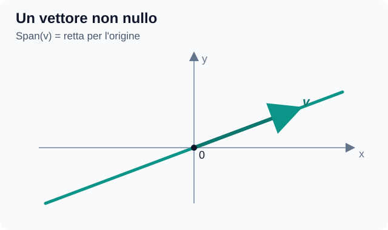
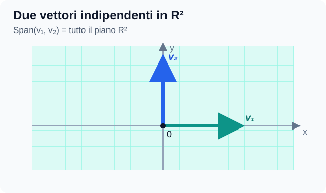
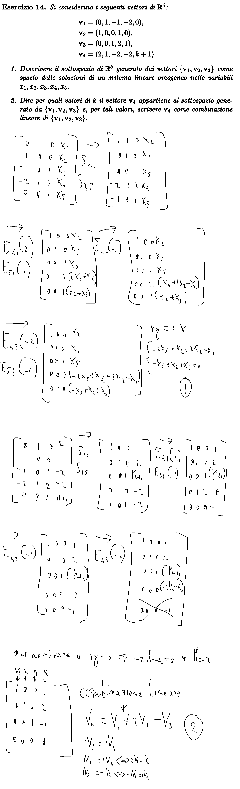

# Appunti di Geometria e Algebra Lineare

**Dispensa:** *Geometria e Algebra Lineare*, Elisa Postinghel  
**Capitolo iniziale:** 4 — Spazi vettoriali (pp. 86–107 del PDF, numerazione stampata)

> Documento incrementale. Qui aggiungeremo spiegazioni, esempi e chiarimenti su richiesta, mantenendo sempre lo stesso nome.

## 4.1 — Spazi vettoriali reali (p. 86)

**Definizione:** Uno spazio vettoriale è un insieme dotato delle operazioni di somma e di prodotto di un elemento per uno scalare.

In uno **spazio vettoriale reale** gli scalari sono numeri reali. Le operazioni devono soddisfare le otto proprietà della Definizione 37 (commutatività e associatività della somma, vettore nullo, opposto, proprietà del prodotto per uno scalare e distributività).

Esempi della dispensa: vettori geometrici, $\mathbb R^n$, matrici $M_{m\times n}(\mathbb R)$, polinomi.

### Che cosa si intende per «vettore»?

Il termine **vettore**, nel suo significato più generale, indica **un elemento di uno spazio vettoriale**. Non va confuso con alcuni suoi casi particolari:

- **Vettore geometrico:** una classe di equivalenza di segmenti orientati.
- **Vettore riga:** una matrice formata da una sola riga.
- **Vettore colonna:** una matrice formata da una sola colonna.

**Attenzione:** questi oggetti non sono sinonimi. La nozione più generale è quella di *vettore come elemento di uno spazio vettoriale*; gli altri sono esempi particolari.

In particolare:

- L'insieme $V^3$ dei **vettori geometrici**, introdotto nel Capitolo 1, è uno spazio vettoriale.
- L'insieme $M_{m\times n}(\mathbb R)$ delle **matrici $m\times n$ a coefficienti reali** è anch'esso uno spazio vettoriale.

## 4.2 — Combinazioni lineari (p. 88)

Una **combinazione lineare** dei vettori $v_1,\ldots,v_k$ è

$$v=\lambda_1v_1+\cdots+\lambda_kv_k.$$

I numeri $\lambda_i$ sono i **coefficienti** o **scalari** (informalmente, i «pesi»).

### 4.2.1 — Forma matriciale (p. 89)

Disponiamo i vettori **nelle colonne** di una matrice:

$$A=[v_1\mid v_2\mid\cdots\mid v_k].$$

Raccogliamo i coefficienti nel **vettore colonna**:

$$\underline{\lambda}= \begin{pmatrix} \lambda_1\\ \lambda_2\\ \vdots\\ \lambda_k \end{pmatrix}.$$

In questo modo, la combinazione lineare diventa $A\underline{\lambda}=v$.

**Chiarimento discusso:** $\underline{\lambda}$ non contiene i vettori originali: contiene soltanto i pesi. Se $A$ ha quattro colonne, $\underline{\lambda}$ ha quattro coefficienti.

## 4.3 — Sottospazi vettoriali e generatori (p. 89)

### 4.3.1 — Sottospazi vettoriali

Un sottoinsieme non vuoto $U\subseteq V$ è un **sottospazio vettoriale** se è chiuso per somma e prodotto per scalare. In modo equivalente, per ogni $u_1,u_2\in U$ e $\lambda_1,\lambda_2\in\mathbb R$,

$$\lambda_1u_1+\lambda_2u_2\in U.$$

Ogni sottospazio deve contenere il **vettore nullo** di $V$, indicato con $0_V$. Questo vale per ogni sottospazio $U\subseteq V$, ma **non** per un sottoinsieme qualsiasi di $V$.

**Test del vettore nullo (condizione necessaria).** Se $U\subseteq\mathbb{R}^n$ **non contiene il vettore nullo**, allora **non è un sottospazio vettoriale**. Infatti, se $U$ è un sottospazio e $v\in U$, per la chiusura rispetto al prodotto per uno scalare deve valere

$$0\cdot v=\mathbf{0}\in U.$$

**Attenzione:** contenere il vettore nullo è **necessario, ma non sufficiente** per essere un sottospazio. Se $\mathbf{0}\in U$, bisogna comunque verificare anche la **chiusura rispetto alla somma** e la **chiusura rispetto al prodotto per uno scalare**.

**Numero di elementi di un sottospazio vettoriale reale.** Un sottospazio $U$ può avere:

- **Un solo elemento:** in questo caso è necessariamente il vettore nullo, quindi $U=\{0_V\}$. Questo insieme è detto **sottospazio nullo**.
- **Infiniti elementi:** se $U$ contiene almeno un vettore non nullo $v$, per la chiusura rispetto al prodotto per uno scalare contiene anche tutti i vettori $\lambda v$, al variare di $\lambda\in\mathbb{R}$; essi sono infiniti e distinti.

**Conclusione:** un sottospazio vettoriale reale ha **un solo elemento (lo zero) oppure infiniti elementi**. Non può avere un numero finito di elementi maggiore di uno.

#### Spazio delle soluzioni di un sistema lineare omogeneo

Un **sistema lineare omogeneo** è un sistema in cui tutti i termini noti sono uguali a zero, e si scrive in forma matriciale $Bx=\mathbf{0}$.

Lo **spazio delle soluzioni** è l'insieme di **tutti i vettori $x$ che soddisfano contemporaneamente le equazioni** del sistema:

$$
U=\{x\in\mathbb{R}^n\mid Bx=\mathbf{0}\}.
$$

Questo insieme è sempre un **sottospazio vettoriale di $\mathbb{R}^n$**: contiene il vettore nullo ed è chiuso rispetto alla somma e al prodotto per uno scalare.

**Da ricordare:** lo stesso sottospazio può essere descritto tramite **generatori** (come Span di alcuni vettori) oppure tramite **equazioni omogenee** che i suoi vettori devono soddisfare.

### 4.3.2 — Generatori (p. 92)

Lo **spazio generato** da $v_1,\ldots,v_k$ contiene tutte le loro combinazioni lineari:

$$\mathrm{Span}(v_1,\ldots,v_k)= \{\lambda_1v_1+\cdots+\lambda_kv_k:\lambda_i\in\mathbb R\}.$$

Un insieme è un **sistema di generatori** di $V$ se il suo span coincide con $V$.

### Significato dello Span

**Span** significa **spazio generato**: è l'insieme di **tutti** i vettori ottenibili facendo combinazioni lineari dei vettori di partenza, non soltanto l'insieme dei vettori iniziali.

Per esempio, dati due vettori $v_1$ e $v_2$:

$$\mathrm{Span}(v_1,v_2) =\{\lambda_1v_1+\lambda_2v_2\mid \lambda_1,\lambda_2\in\mathbb{R}\}.$$

I coefficienti $\lambda_1$ e $\lambda_2$ possono assumere **qualsiasi valore reale**.

**Esempio in $\mathbb{R}^2$.** Prendiamo $v_1=(1,0)$ e $v_2=(0,1)$. Ogni combinazione lineare è

$$\lambda_1(1,0)+\lambda_2(0,1) =(\lambda_1,\lambda_2).$$

Poiché $\lambda_1$ e $\lambda_2$ possono essere qualsiasi numero reale, si ottiene ogni vettore del piano:

$$\boxed{\mathrm{Span}(v_1,v_2)=\mathbb{R}^2}.$$

### Interpretazione geometrica

**1. Un solo vettore non nullo:** il suo Span è la **retta passante per l'origine** nella direzione del vettore.

**2. Due vettori linearmente indipendenti in $\mathbb{R}^2$:** il loro Span è **l'intero piano $\mathbb{R}^2$**.

**Collegamento con le matrici.** Se $A$ ha per colonne i vettori $v_1,\ldots,v_k$, allora

$$v\in\mathrm{Span}(v_1,\ldots,v_k) \quad\Longleftrightarrow\quad A\underline{\lambda}=v \ \text{ammette almeno una soluzione}.$$

I coefficienti cercati sono le componenti del vettore colonna $\underline{\lambda}$.

Per vettori in $\mathbb R^n$, scritti nelle colonne di $A$:

- $v$ appartiene allo spazio generato se il sistema $A\underline{\lambda}=v$ è **compatibile**.
- I vettori generano **tutto $\mathbb R^n$** se e solo se $\mathrm{rg}(A)=n$, dove $n$ è il numero delle **righe**.

## 4.4 — Insiemi linearmente dipendenti e indipendenti (p. 95)

Consideriamo la combinazione lineare che dà il **vettore nullo**:

$$\lambda_1v_1+\cdots+\lambda_kv_k=0 \qquad\Longleftrightarrow\qquad A\underline{\lambda}=0.$$

- **Linearmente indipendenti:** l'unica soluzione è $\lambda_1=\cdots=\lambda_k=0$.
- **Linearmente dipendenti:** esiste una soluzione con coefficienti **non tutti nulli**.

**Chiarimento discusso:** scegliendo tutti i pesi uguali a zero si ottiene sempre il vettore nullo. Questo non prova la dipendenza. La dipendenza esiste quando si può ottenere zero con *almeno un coefficiente non nullo*.

Se un insieme è dipendente, almeno uno dei suoi vettori è combinazione lineare degli altri e può essere eliminato senza modificare lo spazio generato.

**Proprietà — Insiemi che contengono il vettore nullo.** L'insieme formato dal solo vettore nullo, $\{\mathbf{0}\}\subseteq V$, è **linearmente dipendente**. Infatti, $1\cdot\mathbf{0}=\mathbf{0}$: otteniamo il vettore nullo con un coefficiente **non nullo** (uguale a $1$).

Più in generale, **qualsiasi insieme di vettori che contiene il vettore nullo è linearmente dipendente**: basta scegliere coefficiente $1$ per il vettore nullo e coefficiente $0$ per tutti gli altri vettori.

**Attenzione:** il fatto che $\{\mathbf{0}\}$ sia un **sottospazio vettoriale** non significa che sia un insieme linearmente indipendente. Sono proprietà diverse.

**Esempio:**

$$v_1=(1,0),\quad v_2=(0,1),\quad v_3=(1,1).$$

Siccome $v_1+v_2-v_3=0$, con pesi $1,1,-1$ non tutti nulli, i tre vettori sono **dipendenti**.

### Esempio 60 — Indipendenza lineare di matrici (dispensa, p. 96)

**Obiettivo:** verificare, usando la definizione di indipendenza lineare, che le seguenti tre matrici di $M_2(\mathbb{R})$ (matrici $2\times 2$ a coefficienti reali) sono **linearmente indipendenti**:

$$A_1=\begin{pmatrix} 1 & 1\\ 0 & 0 \end{pmatrix}, \qquad A_2=\begin{pmatrix} 0 & 1\\ -1 & 2 \end{pmatrix}, \qquad A_3=\begin{pmatrix} 3 & 0\\ 1 & 0 \end{pmatrix}.$$

**1. Impostiamo la combinazione lineare uguale alla matrice nulla.**

$$\lambda_1 A_1+\lambda_2 A_2+\lambda_3 A_3= \begin{pmatrix} 0 & 0\\ 0 & 0 \end{pmatrix}.$$

Sostituiamo le tre matrici:

$$\lambda_1\begin{pmatrix} 1 & 1\\ 0 & 0 \end{pmatrix} + \lambda_2\begin{pmatrix} 0 & 1\\ -1 & 2 \end{pmatrix} + \lambda_3\begin{pmatrix} 3 & 0\\ 1 & 0 \end{pmatrix} = \begin{pmatrix} 0 & 0\\ 0 & 0 \end{pmatrix}.$$

**2. Moltiplichiamo ogni matrice per il suo coefficiente e sommiamo posizione per posizione.**

$$\begin{pmatrix} \lambda_1 & \lambda_1\\ 0 & 0 \end{pmatrix} + \begin{pmatrix} 0 & \lambda_2\\ -\lambda_2 & 2\lambda_2 \end{pmatrix} + \begin{pmatrix} 3\lambda_3 & 0\\ \lambda_3 & 0 \end{pmatrix} = \begin{pmatrix} 0 & 0\\ 0 & 0 \end{pmatrix}.$$

Quindi:

$$\begin{pmatrix} \lambda_1+3\lambda_3 & \lambda_1+\lambda_2\\ -\lambda_2+\lambda_3 & 2\lambda_2 \end{pmatrix} = \begin{pmatrix} 0 & 0\\ 0 & 0 \end{pmatrix}.$$

**3. Uguagliamo gli elementi che occupano la stessa posizione.** Otteniamo il sistema omogeneo:

$$\begin{cases} \lambda_1+3\lambda_3=0\\ \lambda_1+\lambda_2=0\\ -\lambda_2+\lambda_3=0\\ 2\lambda_2=0 \end{cases}$$

**4. Risolviamo il sistema.** Dall'ultima equazione si ottiene $\lambda_2=0$. Sostituendolo nella seconda e nella terza:

$$\lambda_1=0,\qquad \lambda_3=0.$$

Anche la prima equazione è quindi verificata.

**Conclusione:** l'unica combinazione lineare che produce la matrice nulla ha **tutti i coefficienti uguali a zero**:

$$\boxed{\lambda_1=\lambda_2=\lambda_3=0}.$$

Perciò **$A_1$, $A_2$ e $A_3$ sono linearmente indipendenti**.

**Da ricordare:** per verificare l'indipendenza di matrici si usa lo stesso procedimento usato per i vettori: si impone una combinazione lineare uguale allo **zero dello spazio** (qui la matrice nulla) e si cercano i coefficienti.

### 4.4.1 — Indipendenza lineare e rango (pp. 97–98)

Se $A$ ha come colonne i **$k$ vettori** che stiamo studiando, allora

$$\boxed{\text{vettori indipendenti}\iff\mathrm{rg}(A)=k}.$$

Se il rango è minore del numero delle colonne, i vettori sono dipendenti.

**Non confondere i due confronti:**

- **Indipendenza:** rango uguale al **numero di colonne**.
- **Generatori di tutto $\mathbb R^n$:** rango uguale al **numero di righe**.

**Colonne con pivot:** quando riduciamo $A$ con Gauss, le posizioni dei pivot ci indicano quali colonne della **matrice originale** formano un insieme indipendente. Una colonna senza pivot corrisponde a un vettore che si può ricavare come combinazione lineare dei vettori nelle colonne con pivot.

#### Esempio 61 — Dipendenza lineare e rango (p. 98)

Consideriamo i vettori di $\mathbb{R}^4$:

$$
v_1=(1,2,-1,0),\quad v_2=(0,1,1,3),\quad v_3=(-1,0,3,6).
$$

Disponiamo i vettori **nelle colonne** della matrice:

$$
A=\begin{pmatrix}
1&0&-1\\
2&1&0\\
-1&1&3\\
0&3&6
\end{pmatrix}.
$$

Applichiamo $E_{21}(-2)$ ($R_2\leftarrow R_2-2R_1$) ed $E_{31}(1)$ ($R_3\leftarrow R_3+R_1$):

$$
\begin{pmatrix}
1&0&-1\\
0&1&2\\
0&1&2\\
0&3&6
\end{pmatrix}.
$$

Poi applichiamo $E_{32}(-1)$ ($R_3\leftarrow R_3-R_2$) ed $E_{42}(-3)$ ($R_4\leftarrow R_4-3R_2$):

$$
\begin{pmatrix}
1&0&-1\\
0&1&2\\
0&0&0\\
0&0&0
\end{pmatrix}.
$$

**Conclusione:** $\mathrm{rg}(A)=2<3$, dunque i tre vettori sono **linearmente dipendenti**. La terza colonna non contiene un pivot, quindi $v_3$ è una combinazione lineare di $v_1$ e $v_2$.

#### Esempio 62 — Relazione tra i vettori (continuazione dell'Esempio 61, pp. 98–99)

Ripartiamo dalla matrice dei vettori originali:

$$
A=\begin{pmatrix}
1&0&-1\\
2&1&0\\
-1&1&3\\
0&3&6
\end{pmatrix}.
$$

La riduzione dell'Esempio 61 ha già prodotto la **forma ridotta per righe**:

$$
R=\begin{pmatrix}
1&0&-1\\
0&1&2\\
0&0&0\\
0&0&0
\end{pmatrix}.
$$

Non sono necessarie altre operazioni: le prime due colonne contengono i pivot e la **terza colonna** è $-1$ volta la prima più $2$ volte la seconda. Le operazioni elementari di riga **conservano le relazioni di dipendenza fra le colonne**, quindi la stessa relazione vale per i vettori originali:

$$
\boxed{v_3=-v_1+2v_2}.
$$

**Verifica:** $-(1,2,-1,0)+2(0,1,1,3)=(-1,0,3,6)=v_3$.

## 4.5 — Basi (p. 99)

Una **base** di uno spazio vettoriale è un insieme di vettori che:

1. **genera** lo spazio;
2. è **linearmente indipendente**.

Una base permette dunque di generare tutto lo spazio **senza vettori ridondanti**.

### 4.5.1 — Basi di $\mathbb R^n$

Per essere una base di $\mathbb R^n$, un insieme deve avere $n$ vettori e la matrice corrispondente deve avere rango $n$.

La **base canonica** è formata dai vettori con un solo 1 e tutte le altre componenti uguali a 0.

Ogni vettore dello spazio si esprime **in maniera unica** come combinazione lineare dei vettori di una base.

### Esempio 65 — Ricavare i coefficienti di un vettore rispetto a una base (p. 100)

**Metodo:** per esprimere un vettore $v$ come combinazione lineare della base $B=\{v_1,\ldots,v_n\}$ di $\mathbb{R}^n$:

1. Disponiamo i vettori della base **nelle colonne** di $A$.
2. Aggiungiamo **a destra** la colonna del vettore $v$, formando la matrice aumentata $(A\mid v)$.
3. Riduciamo la matrice **per righe fino alla forma ridotta**, in cui le prime $n$ colonne diventano la matrice identità $I_n$.
4. Leggiamo i **coefficienti cercati nell'ultima colonna**: se essa contiene $\lambda_1,\ldots,\lambda_n$, allora $v=\lambda_1v_1+\cdots+\lambda_nv_n$.

**Esempio della dispensa.** Consideriamo la base dell'Esempio 64:

$$
v_1=(1,1,0),\quad v_2=(1,0,1),\quad v_3=(0,1,1)
$$

e il vettore $v=(4,3,2)$. Aggiungiamo $v$ come **quarta colonna**:

$$
(A\mid v)=\begin{pmatrix}
1&1&0&4\\
1&0&1&3\\
0&1&1&2
\end{pmatrix}.
$$

Riducendo completamente per righe si ottiene:

$$
\begin{pmatrix}
1&0&0&\frac{5}{2}\\
0&1&0&\frac{3}{2}\\
0&0&1&\frac{1}{2}
\end{pmatrix}.
$$

Le prime tre colonne sono l'identità; **la quarta contiene i coefficienti della combinazione lineare**:

$$
\boxed{v=\frac{5}{2}v_1+\frac{3}{2}v_2+\frac{1}{2}v_3}.
$$

**Attenzione:** i coefficienti si leggono direttamente nella colonna aggiunta **quando la parte sinistra è diventata l'identità**, non da una qualsiasi matrice a scalini. Poiché i vettori di partenza sono una **base**, questa combinazione lineare è **unica**.

**Precisazione importante — Criterio di appartenenza allo spazio generato.** Se $U=\mathrm{Span}(u_1,\ldots,u_r)$ e $A$ ha per colonne i vettori $u_1,\ldots,u_r$, allora un vettore $v$ **appartiene a $U$ se e solo se** la matrice $A$ e la matrice aumentata $(A\mid v)$ hanno **lo stesso rango**:

$$
\boxed{v\in U\iff \mathrm{rg}(A)=\mathrm{rg}(A\mid v)}.
$$

Questo criterio verifica **se esistono coefficienti** tali che $A\lambda=v$. Se il rango aumenta aggiungendo $v$, allora $v$ **non** appartiene allo spazio generato. Per **trovare i coefficienti**, bisogna invece risolvere il sistema (come nell'Esempio 65).

**Esempio — Conclusione dell'Esercizio 13 (pp. 101–103).** In $\mathbb{R}^4$ siano

$$
u_1=(2,3,1,-1),\quad
u_2=(2,1,1,1),\quad
u_3=(0,2,0,-2).
$$

Poiché $u_3=u_1-u_2$, una **base** di $U=\mathrm{Span}(u_1,u_2,u_3)$ è $\{u_1,u_2\}$ e la matrice $A=(u_1\mid u_2)$ ha rango $2$.

Per stabilire quando $v=(k,k,k-2,0)$ appartiene a $U$, aggiungiamo $v$ come terza colonna:

$$
(A\mid v)=
\begin{pmatrix}
2&2&k\\
3&1&k\\
1&1&k-2\\
-1&1&0
\end{pmatrix}.
$$

La riduzione per righe porta a:

$$
\begin{pmatrix}
2&2&k\\
0&-2&-\frac{k}{2}\\
0&0&\frac{k}{2}-2\\
0&0&0
\end{pmatrix}.
$$

Il rango della matrice aumentata resta $2$ **solo se** $\frac{k}{2}-2=0$, cioè **$k=4$**. Pertanto:

$$
\boxed{v\in U\iff k=4}.
$$

In quel caso, $v=(4,4,2,0)=u_1+u_2$.

## 4.6 — Esercizi ricapitolativi (p. 101)

### Esercizio 13 — Sottospazio generato e appartenenza di un vettore

*Trascrizione ordinata dello svolgimento fornito negli appunti manoscritti.*

**Testo.** In $\mathbb{R}^4$ sono dati:

$$
u_1=(2,3,1,-1),\quad u_2=(2,1,1,1),\quad u_3=(0,2,0,-2).
$$

1. Trovare una **base** del sottospazio $U=\mathrm{Span}(u_1,u_2,u_3)$.
2. Stabilire per quali valori reali di $k$ il vettore $v=(k,k,k-2,0)$ **appartiene a $U$**.

#### Punto 1 — Trovare una base

Disponiamo i vettori nelle colonne:

$$
A=\begin{pmatrix}
2&2&0\\
3&1&2\\
1&1&0\\
-1&1&-2
\end{pmatrix}.
$$

Scambiando la prima e la terza riga e applicando Gauss:

$$
\begin{pmatrix}
1&1&0\\
3&1&2\\
2&2&0\\
-1&1&-2
\end{pmatrix}
\longrightarrow
\begin{pmatrix}
1&1&0\\
0&-2&2\\
0&0&0\\
0&2&-2
\end{pmatrix}
\longrightarrow
\begin{pmatrix}
1&1&0\\
0&-2&2\\
0&0&0\\
0&0&0
\end{pmatrix}.
$$

Normalizziamo il secondo pivot ed eliminiamo l'elemento sopra di esso:

$$
\begin{pmatrix}
1&1&0\\
0&-2&2\\
0&0&0\\
0&0&0
\end{pmatrix}
\longrightarrow
\begin{pmatrix}
1&1&0\\
0&1&-1\\
0&0&0\\
0&0&0
\end{pmatrix}
\longrightarrow
\begin{pmatrix}
1&0&1\\
0&1&-1\\
0&0&0\\
0&0&0
\end{pmatrix}.
$$

I pivot sono nelle **prime due colonne**, quindi scegliamo i corrispondenti **vettori originali**:

$$
\boxed{B=\{u_1,u_2\}}.
$$

Infatti $u_3=u_1-u_2$: il terzo vettore è ridondante e $\mathrm{rg}(A)=2$.

#### Punto 2 — Verificare se il vettore appartiene a $U$

Aggiungiamo il vettore $v=(k,k,k-2,0)$ come **ultima colonna**:

$$
(A\mid v)=\begin{pmatrix}
2&2&0&k\\
3&1&2&k\\
1&1&0&k-2\\
-1&1&-2&0
\end{pmatrix}.
$$

Con lo scambio tra la prima e la terza riga, seguito dall'eliminazione:

$$
\begin{pmatrix}
1&1&0&k-2\\
3&1&2&k\\
2&2&0&k\\
-1&1&-2&0
\end{pmatrix}
\longrightarrow
\begin{pmatrix}
1&1&0&k-2\\
0&-2&2&6-2k\\
0&0&0&4-k\\
0&2&-2&k-2
\end{pmatrix}
\longrightarrow
\begin{pmatrix}
1&1&0&k-2\\
0&-2&2&6-2k\\
0&0&0&4-k\\
0&0&0&4-k
\end{pmatrix}.
$$

**Conclusione.** Il vettore appartiene allo spazio generato esattamente quando l'aggiunta della sua colonna **non aumenta il rango**:

$$
v\in U \iff \mathrm{rg}(A)=\mathrm{rg}(A\mid v).
$$

Qui $\mathrm{rg}(A)=2$; la matrice aumentata ha ancora rango $2$ soltanto quando $4-k=0$. Dunque:

$$
\boxed{v\in U\iff k=4}.
$$

Per $k=4$ risulta inoltre $v=(4,4,2,0)=u_1+u_2$.

**Da ricordare:** per verificare l'appartenenza allo spazio generato basta confrontare i ranghi; per ricavare i coefficienti della combinazione lineare si risolve il sistema $(A\mid v)$.

### Esercizio 14 — Testo e svolgimento manoscritto (Samsung Notes)

*Immagine estratta dal file Samsung Notes: comprende il testo dell'esercizio e tutti i passaggi dello svolgimento manoscritto.*

---

## Appunti personali e chiarimenti successivi

*Questa sezione verrà aggiornata di volta in volta, senza creare nuovi file.*
